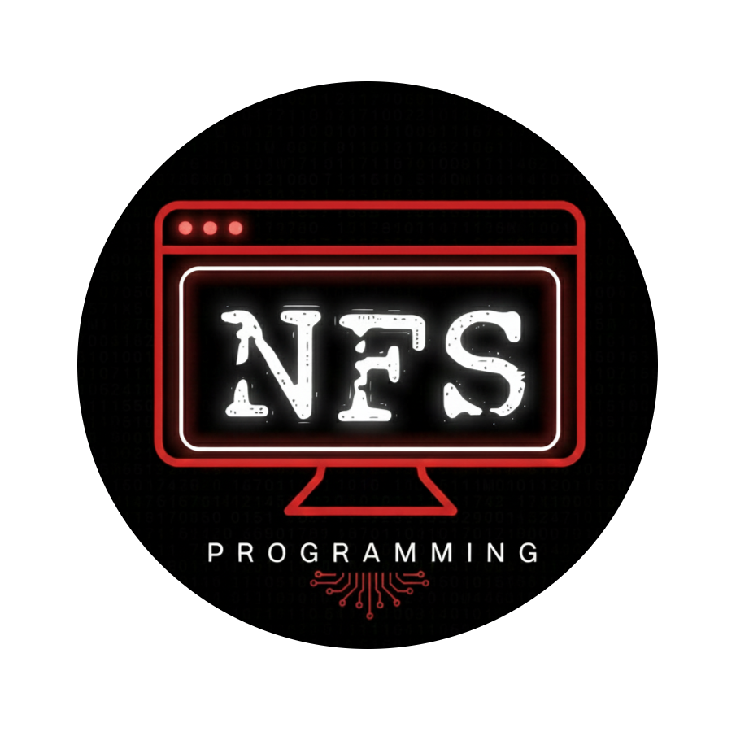

# Dream in Parallel

<p align="center">
  
</p>

<p align="center">
  <strong>High-performance AI image generation workstation built with Next.js 16, React 19, and Tailwind CSS v4.</strong><br />
  Concurrent multi-variation generation, sequential pre-load queue management, and automated dual-tier prompt engineering.
</p>

---

## Overview

**Dream in Parallel** is an AI-powered image generation application that overcomes single-image latency and rate-limiting bottlenecks. Built on Next.js 16 (Turbopack) and React 19, the platform coordinates concurrent image generation requests through a throttled client-side queue while running user inputs through a dual-stage prompt enhancement pipeline.

Users can input brief concepts (e.g. `"cyberpunk alleyway"` or `"basmati rice macro"`), automatically expand them into high-fidelity studio descriptors, and render 1, 2, 4, or 8 image variations concurrently with per-image retry mechanics and direct clipboard extraction.

---

## Implemented Features

- **Concurrent Batch Generation:** Render batches of 1, 2, 4, or 8 image variations in parallel. Requests use a sequential pre-loading queue with an 800ms stagger to prevent client-side queue congestion and HTTP rate limiting.
- **Dual-Tier Prompt Enhancement Engine:**
  - **Tier 1 (AI Brain):** Asynchronously dispatches user concepts to the Pollinations text API with an AbortController timeout (5 seconds) to transform keywords into photographic prompts.
  - **Tier 2 (Heuristic Fallback Master Builder):** If external AI services time out or fail, a local rule-based engine categorizes intent (rice/grains, ingredients, portraits, landscapes, sci-fi, graphic design) and injects photographic metadata (lighting, lenses, styles, textures, quality boosters).
- **Interactive Image Cards:**
  - **Per-Image Retry:** Individual failed tiles can be re-triggered independently with freshly calculated seed values and timestamp cache-busters without re-running the entire batch.
  - **Quick Export & Copy:** Hover actions enable one-click prompt copying to the system clipboard and direct full-resolution image downloads in a new browser tab.
- **Dynamic Glassmorphism UI:** Built with Tailwind CSS v4 and Framer Motion, featuring radial ambient background glows, animated loading skeleton cards with progress indicators, and responsive grid layouts.
- **Zero API Key Requirement:** Integrates directly with Pollinations API for image and text transformations without requiring mandatory third-party billing accounts or secret API tokens.

---

## Tech Stack

| Layer | Technology | Version | Purpose |
| :--- | :--- | :--- | :--- |
| **Framework** | Next.js (App Router, Turbopack) | `^16.1.1` | Application framework & SSR/SSG engine |
| **Runtime / Library** | React & React DOM | `19.2.3` | Client component rendering & state management |
| **Language** | TypeScript | `^5` | Strict static type checking |
| **Styling** | Tailwind CSS & PostCSS | `^4` | Utility-first styling & design tokens |
| **Motion** | Framer Motion | `^12.23.26` | Card transitions and layout animations |
| **Icons** | Lucide React | `^0.562.0` | Vector interface iconography |
| **UI Primitives** | Radix UI Slot & CVA | `^1.2.4` / `^0.7.1` | Accessible component variants |
| **Image Engine** | Pollinations AI | Free API | Serverless image rendering (`sana`, `flux`, `turbo`) |

---

## Project Structure

```text
Dream in Parallel/
├── app/
│   ├── globals.css         # Tailwind v4 theme tokens, color variables & background shaders
│   ├── icon.png            # Application branding icon
│   ├── layout.tsx          # Root HTML layout with Geist font configurations & metadata
│   └── page.tsx            # Main interactive generation workstation & gallery component
├── components/
│   └── ui/
│       ├── button.tsx      # CVA-styled accessible button component
│       ├── card.tsx        # Glassmorphic container card primitives
│       └── input.tsx       # Styled form input field
├── lib/
│   ├── api.ts              # Image generation, preloading, and prompt engineering logic
│   └── utils.ts            # Class name merging utility (clsx + tailwind-merge)
├── public/                 # Static assets directory
├── eslint.config.mjs       # ESLint 9 configuration with Next.js core web vitals
├── next.config.ts          # Next.js configuration
├── package.json            # Project manifest, dependencies, and scripts
├── postcss.config.mjs      # PostCSS 8 configuration with @tailwindcss/postcss
├── tsconfig.json           # TypeScript configuration
└── LICENSE                 # MIT License
```

---

## Prerequisites

- **Node.js:** `v18.18.0` or higher (`v20.x` or `v22.x` recommended)
- **npm:** `v9.x` or higher

---

## Installation & Quick Start

1. **Clone the repository:**
   ```bash
   git clone https://github.com/nfsprogramming/Dream-in-Parallel.git
   cd Dream-in-Parallel
   ```

2. **Install dependencies:**
   ```bash
   npm ci
   ```

3. **Start the local development server:**
   ```bash
   npm run dev
   ```
   Open [http://localhost:3000](http://localhost:3000) in your browser.

4. **Run static analysis & linting:**
   ```bash
   npm run lint
   ```

5. **Build for production:**
   ```bash
   npm run build
   ```

6. **Run the production build locally:**
   ```bash
   npm run start
   ```

---

## Configuration & Customization

The core parameters for models and prompt enhancements are centralized in `lib/api.ts` and `app/page.tsx`:

- **Model Selection:** `generateImage` supports model mapping via the Pollinations API:
  - `sana` (mapped from default `nano-banana-pro`): High stability, fast execution.
  - `flux`: Photorealistic, detailed rendering.
  - `turbo`: Ultra-fast generation.
- **Queue Throttling:** The sequential stagger delay between batch requests can be adjusted in `app/page.tsx` (default: `800ms`).
- **Styles & Modifiers:** Style options (`cinematic`, `artistic`, `fantasy`, `scifi`, `vintage`, `macro`) and intent keywords can be extended directly in the `enhancePromptManual` function in `lib/api.ts`.

---

## Limitations

- **Public API Dependency:** Image rendering and AI prompt expansion rely on Pollinations AI public endpoints. Generation speed and availability depend on remote server load.
- **Client-Side CORS Preloading:** The pre-loading mechanism instantiates browser `Image` objects to stagger requests; in offline or strictly sandboxed network environments, remote image URLs will not load.
- **No Persistent Storage:** Generated images are hosted ephemerally on the remote cache. Users should save or download outputs directly to local storage.

---

## Releases

Official releases, packaged distribution archives, and checksums are published on GitHub Releases:
- [GitHub Releases](https://github.com/nfsprogramming/Dream-in-Parallel/releases)

---

## Contributing

Contributions, bug reports, and improvements are welcome.
1. Fork the repository.
2. Create your feature branch (`git checkout -b feature/enhancement-name`).
3. Ensure linting and build checks pass (`npm run lint && npm run build`).
4. Commit your changes with concise, descriptive commit messages.
5. Push to the branch and open a Pull Request.

---

## License

This project is licensed under the [MIT License](LICENSE) © 2026 nfsprogramming.
